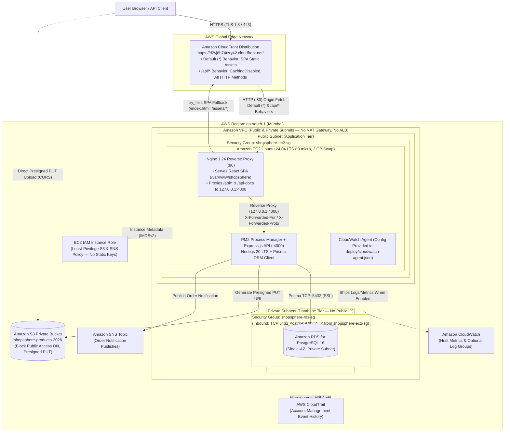

# ShopSphere: Cloud-Based E-Commerce Platform Using AWS Cloud Architecture

**ShopSphere** is a full-stack, cloud-native e-commerce platform designed, hardened, and deployed on **Amazon Web Services (`ap-south-1` Mumbai)** for the **BCSE355L Cloud Architecture Design (Direct Assessment III)** course at **Vellore Institute of Technology, Chennai**. The application delivers a complete customer shopping and order-management experience alongside a role-protected administrative suite, fronted globally by **Amazon CloudFront** over HTTPS (`https://d2yj8h74tzry42.cloudfront.net/`) and backed by **Nginx**, **PM2**, **Node.js / Express**, **Prisma ORM**, private-subnet **Amazon RDS for PostgreSQL**, private **Amazon S3 (`shopsphere-products-2026`)**, and **Amazon SNS**.

- **Live Storefront (CloudFront HTTPS):** https://d2yj8h74tzry42.cloudfront.net/
- **Live API Health Check (`GET /api/health`):** https://d2yj8h74tzry42.cloudfront.net/api/health
- **Live Database Health Check (`GET /api/health/db`):** https://d2yj8h74tzry42.cloudfront.net/api/health/db
- **GitHub Repository:** https://github.com/AdityaNarayan1212/ShopSphere
- **DA III Word Report Source Document:** [`docs/DA-III-content.md`](./docs/DA-III-content.md)

---

## Table of Contents

1. [Project Title & Introduction](#1-project-title--introduction)
2. [Academic Details & Team Attribution](#2-academic-details--team-attribution)
3. [Abstract](#3-abstract)
4. [Problem Statement](#4-problem-statement)
5. [Project Objectives](#5-project-objectives)
6. [Project Highlights & Novelty](#6-project-highlights--novelty)
7. [Technology Stack](#7-technology-stack)
8. [Implemented Features](#8-implemented-features)
9. [AWS Architecture & Request/Data Flow](#9-aws-architecture--requestdata-flow)
10. [Architecture Diagram](#10-architecture-diagram)
11. [Live Demo Links](#11-live-demo-links)
12. [GitHub Repository & Academic Citation](#12-github-repository--academic-citation)
13. [API Documentation](#13-api-documentation)
14. [Local Installation Instructions (Windows PowerShell & Bash)](#14-local-installation-instructions-windows-powershell--bash)
15. [Database Initialization & Sample-Data Seeding](#15-database-initialization--sample-data-seeding)
16. [Production AWS Deployment Overview](#16-production-aws-deployment-overview)
17. [Security Considerations](#17-security-considerations)
18. [Testing Methodology & Verified Results](#18-testing-methodology--verified-results)
19. [Limitations & Future Enhancements](#19-limitations--future-enhancements)
20. [Cost Considerations](#20-cost-considerations)
21. [Conclusion](#21-conclusion)
22. [References](#22-references)
23. [Screenshot Index & Evidence Checklist](#23-screenshot-index--evidence-checklist)
24. [Appendix & Research Paper Status](#24-appendix--research-paper-status)

---

## 1. Project Title & Introduction

**Title:** *ShopSphere: Cloud-Based E-Commerce Platform Using AWS Cloud Architecture*

ShopSphere is a modular TypeScript monorepo (`client/` and `server/` npm workspaces) that implements an Amazon/Flipkart-inspired online retail platform. It demonstrates how a production web application can be architected on AWS using a single-origin CloudFront edge distribution, an Ubuntu 24.04 EC2 application server running Nginx and PM2, a private RDS PostgreSQL database protected by security-group chaining, and IAM instance roles for credential-free S3 presigned uploads and SNS order notifications—while strictly avoiding paid-by-default networking appliances such as NAT Gateways or Application Load Balancers.

---

## 2. Academic Details & Team Attribution

| Field | Details |
|---|---|
| **Institution** | Vellore Institute of Technology, Chennai (School of Computer Science and Engineering) |
| **Course Title** | Cloud Architecture Design |
| **Course Code** | `BCSE355L` |
| **Assessment** | Direct Assessment III (DA III) |
| **Submission Deadline** | October 30, 2026, at 11:59 PM |
| **Team Member 1** | **Adityaranjan Narayan** — `24BCE1565` |
| **Team Member 2** | **Vedant Bidkar** — `24BCE1596` |
| **Faculty Supervisor** | **Dr. S Vigneshwari** |

### Team Contribution Checklist

Adityaranjan Narayan led the end-to-end cloud architecture, backend hardening, AWS deployment, and verification work. Use the checklist below when finalizing the individual contribution breakdown in the DA III Word submission:

| Area / Deliverable | Primary Lead / Status | Notes for Final Submission Review |
|---|---|---|
| AWS VPC, Security Groups, EC2, Private RDS, S3 (`shopsphere-products-2026`), SNS & CloudFront Setup | Adityaranjan Narayan | Deployed and verified in `ap-south-1` (`https://d2yj8h74tzry42.cloudfront.net/`) |
| Backend Production Hardening, Prisma Migrations, Seed Safety & JWT Security Fixes | Adityaranjan Narayan | Implemented on `deploy-fixes` and merged to `main` |
| Deployment Automation (`deploy/`), Smoke Tests (`scripts/smoke-test.sh`) & Load Test Script (`loadtest/k6.js`) | Adityaranjan Narayan | Verified locally and against live CloudFront endpoints |
| Repository Documentation, Architecture Diagrams & DA III Report Preparation | Adityaranjan Narayan & Vedant Bidkar | `[ ]` Confirm specific report sections / screenshot captures completed by each team member before final upload |

---

## 3. Abstract

ShopSphere is a cloud-based e-commerce platform developed and deployed on AWS (`ap-south-1`) to demonstrate secure, cost-optimized cloud architecture design. The system pairs a **React 18 + Vite + TypeScript + Tailwind CSS** single-page storefront with a **Node.js 20 + Express + Prisma 6** REST API backed by **Amazon RDS for PostgreSQL 16**. Public traffic enters exclusively over HTTPS through **Amazon CloudFront** (`https://d2yj8h74tzry42.cloudfront.net/`), which routes static storefront requests via its default (`*`) behavior and forwards dynamic `/api/*` requests with caching disabled to **Nginx (`1.24.0`)** on an **Ubuntu 24.04 LTS EC2 (`t3.micro`)** instance. Nginx serves the compiled SPA bundle and proxies API calls over loopback (`127.0.0.1:4000`) to a **PM2-managed Express** server. Relational customer and order data are isolated in private subnets on Single-AZ RDS PostgreSQL, accessible solely from the EC2 security group (`shopsphere-ec2-sg -> shopsphere-rds-sg:5432`). Product image uploads use 300-second presigned `PUT` URLs to the private **Amazon S3** bucket `shopsphere-products-2026`, and order alerts publish to **Amazon SNS**, both authenticated via an **EC2 IAM Instance Role** without static AWS keys.

---

## 4. Problem Statement

Traditional student and small-scale cloud deployments commonly exhibit three structural vulnerabilities:
1. **Direct Database Exposure:** Provisioning relational databases with public IP addresses and permissive security group rules (`0.0.0.0/0`) exposes sensitive user credentials and order records.
2. **Static Credential Leakage:** Storing long-lived `AWS_ACCESS_KEY_ID` and `AWS_SECRET_ACCESS_KEY` strings in `.env` files or source code creates high risk of account compromise on public Git repositories.
3. **Avoidable Infrastructure Cost & Mixed-Content Errors:** Deploying managed NAT Gateways, Application Load Balancers, or Multi-AZ clusters rapidly exhausts student credits, while serving a frontend over HTTPS and a backend over raw EC2 HTTP causes browser mixed-content and CORS failures.

ShopSphere addresses these challenges through a single-origin CloudFront edge architecture, a Zero-NAT public/private VPC layout with strict security-group chaining, `Serializable` ACID database transactions, and IAM role-based S3/SNS access.

---

## 5. Project Objectives

1. **Design a Two-Tier VPC Architecture (`ap-south-1`):** Separate the public EC2 web/application tier from the private RDS PostgreSQL database tier using security-group chaining without a NAT Gateway.
2. **Terminate HTTPS & Unify Origins via CloudFront:** Serve both the React SPA (`*`) and Express REST API (`/api/*`, caching disabled) behind `https://d2yj8h74tzry42.cloudfront.net/`.
3. **Eliminate Static Cloud Keys:** Authenticate S3 presigned uploads (`shopsphere-products-2026`) and SNS order notifications exclusively through an EC2 IAM instance role.
4. **Enforce Transactional & Application Security:** Use Prisma `Serializable` transactions for stock-safe order placement, bcrypt (cost 12) password hashing, whitelisted JWT claims (`{ id, role, email }`), Zod validation, Helmet headers, proxy-aware rate limiting, and fail-fast production startup checks.
5. **Provide Reproducible Deployment & Verification Tooling:** Supply idempotent Ubuntu 24.04 setup/deploy scripts (`deploy/`), automated smoke tests (`scripts/smoke-test.sh`), and a `k6` load test (`loadtest/k6.js`).

---

## 6. Project Highlights & Novelty

- **Dual-Behavior Single-Origin CloudFront Routing:** Static assets (`/assets/*`) are served with `Cache-Control: public, max-age=31536000, immutable` (`X-Cache: Hit from cloudfront`), while `/api/*` enforces `CachingDisabled` (`X-Cache: Miss from cloudfront`) and forwards `Authorization` headers and all REST methods (`GET, HEAD, OPTIONS, PUT, POST, PATCH, DELETE`) to EC2 Nginx.
- **Zero-NAT Private Database Isolation:** RDS PostgreSQL runs in private subnets (`Publicly accessible = No`) and accepts TCP `5432` only from `shopsphere-ec2-sg`, achieving full database isolation without hourly NAT Gateway or ALB charges.
- **ACID `Serializable` Order Placement & Inventory Ledger:** Checkout (`POST /api/orders`) runs inside a PostgreSQL `Serializable` transaction that verifies live stock, decrements inventory, records an `InventoryMovement` audit entry (`ORDER_PLACED`, `ORDER_CANCELLED`, `ADMIN_STOCK_ADJUSTMENT`), creates the order and payment records, and empties the customer's cart atomically.
- **Production Fail-Fast & Seed Safety Guards:** In production (`NODE_ENV=production`), the server refuses to start without a `DATABASE_URL` and a `JWT_SECRET` of at least 32 characters, and `prisma/seed.ts` refuses to run if default demo passwords are supplied.
- **JWT Claim Whitelisting & Redacted Structured Logging:** Tokens include only `{ id, role, email, iat, exp }` (never `passwordHash`), and the HTTP logger outputs one JSON line per request (`method`, `path`, `status`, `ms`) without logging `Authorization` headers or request payloads.

---

## 7. Technology Stack

| Layer | Technology | Version (Locked) | Purpose |
|---|---|---|---|
| **Frontend UI** | React, React Router (`BrowserRouter`), TypeScript | React `18.3.1`, Router `6.30.6`, TS `5.9.3` | Component-driven SPA storefront, cart, checkout, order history, and admin console |
| **Frontend Build & Styling** | Vite, Tailwind CSS, Lucide React, Axios | Vite `6.4.5`, Tailwind `3.4.19`, Axios `1.20.0` | Bundling, `/api` dev proxy, responsive UI styling, and bearer-token API client |
| **Backend Runtime & API** | Node.js (ESM / `NodeNext`), Express.js | Node `20 LTS` / `22.x`, Express `4.22.3` | REST API server, routing, middleware pipeline, and graceful `SIGTERM`/`SIGINT` shutdown |
| **Database & ORM** | PostgreSQL, Prisma ORM | PostgreSQL `16`, Prisma `6.19.3` | 12-model relational schema, migrations (`prisma migrate deploy`), and `Serializable` transactions |
| **Authentication & Security** | `bcryptjs`, `jsonwebtoken`, `zod`, `helmet`, `express-rate-limit`, `cors` | `bcryptjs 2.4.3`, `jwt 9.0.3`, `zod 3.25.76`, `helmet 8.3.0` | Password hashing (cost 12), stateless JWT auth, input validation, HTTP security headers, auth rate limiting |
| **AWS SDK Integrations** | `@aws-sdk/client-s3`, `@aws-sdk/s3-request-presigner`, `@aws-sdk/client-sns` | `3.1156.0` | Presigned S3 `PUT` URLs (`shopsphere-products-2026`) and SNS order notifications via EC2 IAM role |
| **Edge, Web & Process Tier** | Amazon CloudFront, Nginx, PM2, Ubuntu 24.04 LTS | Nginx `1.24.0`, Ubuntu `24.04` | HTTPS termination, SPA static hosting, `/api/*` reverse proxy, and process supervision |

---

## 8. Implemented Features

### Customer Storefront & Shopping Flow
- **Catalogue Discovery & Filtering (`/`, `/products`):** Browse seeded products with keyword search (`q` across name, description, and brand), category filter (`category`), price range (`minPrice`, `maxPrice`), minimum rating (`rating`), stock filter (`inStock=true`), sorting (`popular`, `price-asc`, `price-desc`, `newest`, `rating`), and pagination.
- **Product Details (`/products/:id`):** View full product specifications, discount percentage, stock count, customer reviews (`GET /api/products/:id/reviews`), and related products in the same category.
- **Authentication (`/login`, `/register`):** Customer registration, login, session persistence (`/api/auth/me`), and logout.
- **Shopping Cart (`/cart`):** Add items (`POST /api/cart/items`), update quantities with live stock validation (`PATCH /api/cart/items/:id`), remove items (`DELETE /api/cart/items/:id`), and view automatic INR subtotal and free-shipping threshold calculation (free shipping on orders $\ge$ ₹999, otherwise ₹49).
- **Address Management & Checkout (`/checkout`):** Save delivery addresses (`POST /api/addresses`) and place orders (`POST /api/orders`) using Cash on Delivery (`COD`) or clearly labeled demo mock payment (`MOCK`).
- **Order History & Cancellation (`/orders`):** Inspect placed orders (`SS-...`) and cancel `PENDING` or `CONFIRMED` orders (`POST /api/orders/:id/cancel`) with automatic stock restoration and `ORDER_CANCELLED` inventory audit logging.
- **Wishlist & Product Reviews (`/wishlist`, REST API):** View and remove saved wishlist items in the UI (`/wishlist`), with full backend endpoints for adding wishlist items (`POST /api/wishlist/items`) and submitting verified-purchase reviews (`POST /api/products/:id/reviews` for `SHIPPED`/`DELIVERED` orders).

### Administrator Console (`/admin`, `Role.ADMIN`)
- **KPI Dashboard (`GET /api/admin/dashboard`):** Live counts of active products, registered customers, total orders, pending/confirmed orders, low-stock alerts ($\le 5$ units), recent orders, and cumulative revenue.
- **Product & Inventory Management:** Create new products (`POST /api/admin/products`), update product details/stock with automatic `ADMIN_STOCK_ADJUSTMENT` ledger entries (`PATCH /api/admin/products/:id`), and soft-deactivate products (`DELETE /api/admin/products/:id`).
- **Order Lifecycle Management:** View all customer orders (`GET /api/admin/orders`) and enforce valid state transitions (`PENDING -> CONFIRMED -> PROCESSING -> SHIPPED -> DELIVERED` or `CANCELLED`) via `PATCH /api/admin/orders/:id/status`.
- **Customer & S3 Upload Endpoints:** Inspect customer accounts and toggle active status (`GET /api/admin/customers`, `PATCH /api/admin/customers/:id/active`), and generate 300-second S3 presigned upload URLs (`POST /api/admin/uploads/presign`) for `image/jpeg`, `image/png`, and `image/webp`.

---

## 9. AWS Architecture & Request/Data Flow

Detailed architecture documentation is maintained in **[`docs/aws-architecture.md`](./docs/aws-architecture.md)**.

### Deployed AWS Components (`ap-south-1`)
1. **Amazon CloudFront (`https://d2yj8h74tzry42.cloudfront.net/`):** Public HTTPS entry point redirecting HTTP to HTTPS (`301`). Uses the EC2 Nginx server as its origin with two behaviors:
   - **Default (`*`):** Serves the React SPA (`index.html`) and cached static bundles (`/assets/*`).
   - **API (`/api/*`):** Caching disabled (`X-Cache: Miss from cloudfront`), all HTTP methods enabled (`GET, HEAD, OPTIONS, PUT, POST, PATCH, DELETE`), forwarding `Authorization`, `Content-Type`, and query parameters to Nginx.
2. **Amazon VPC (Public & Private Subnets, No NAT Gateway):** Isolates the public compute tier from the private database tier without NAT Gateway charges.
3. **Amazon EC2 (`t3.micro`, Ubuntu 24.04 LTS, 2 GB Swap):** Runs **Nginx `1.24.0`** on port `80` (serving `/var/www/shopsphere` and proxying `/api/` and `/api-docs` to `127.0.0.1:4000`) and **PM2** managing the **Node.js 20 + Express** server. Protected by `shopsphere-ec2-sg`.
4. **Amazon RDS for PostgreSQL 16 (Single-AZ, Private Subnets):** Stores all 12 Prisma models with `Publicly accessible = No`. Protected by `shopsphere-rds-sg`, which allows TCP `5432` **only** from `shopsphere-ec2-sg`.
5. **EC2 IAM Instance Role (`shopsphere-ec2-role`):** Grants least-privilege `s3:PutObject`/`s3:GetObject` on `arn:aws:s3:::shopsphere-products-2026/products/*` and `sns:Publish` on the order notification topic ([`deploy/iam/ec2-role-policy.json`](./deploy/iam/ec2-role-policy.json)) with zero static AWS keys.
6. **Amazon S3 (`shopsphere-products-2026`):** Private bucket (`Block all public access = ON`) for presigned product image uploads. (No separate S3 CloudFront distribution is deployed.)
7. **Amazon SNS:** Publishes order notification messages (`Subject: "ShopSphere order update"`) on checkout.
8. **CloudWatch & CloudTrail:** Express emits structured JSON request logs to PM2 logs, and [`deploy/cloudwatch-agent.json`](./deploy/cloudwatch-agent.json) provides agent configuration for `/shopsphere/nginx`, `/shopsphere/api`, and memory/disk metrics. Standard EC2/RDS CloudWatch metrics and AWS CloudTrail 90-day management event history are provided by AWS; custom agent log delivery and persistent trails are documented according to verified console evidence rather than assumed from config files alone.

---

## 10. Architecture Diagram

Canonical Mermaid source: **[`docs/architecture.mmd`](./docs/architecture.mmd)**



---

## 11. Live Demo Links

| Endpoint | Live URL | Verified Behavior |
|---|---|---|
| **Storefront SPA** | https://d2yj8h74tzry42.cloudfront.net/ | Loads React 18 storefront over CloudFront HTTPS |
| **Product Catalogue Page** | https://d2yj8h74tzry42.cloudfront.net/products | Client-side route served via Nginx `try_files` fallback |
| **Service Health Check** | https://d2yj8h74tzry42.cloudfront.net/api/health | Returns `{"status":"ok","service":"shopsphere-api","timestamp":"..."}` |
| **Database Health Check** | https://d2yj8h74tzry42.cloudfront.net/api/health/db | Executes `SELECT 1` on private RDS PostgreSQL and returns `{"status":"ok","db":"up","timestamp":"..."}` |
| **Product Catalogue API** | https://d2yj8h74tzry42.cloudfront.net/api/products | Returns paginated JSON of the 8 seeded products (`X-Cache: Miss from cloudfront`) |
| **OpenAPI / Swagger UI** | https://d2yj8h74tzry42.cloudfront.net/api-docs/ | Interactive OpenAPI 3.0 documentation |

---

## 12. GitHub Repository & Academic Citation

- **GitHub Repository:** https://github.com/AdityaNarayan1212/ShopSphere
- **Citation Metadata File:** [`CITATION.cff`](./CITATION.cff)

### Academic Citation

> Adityaranjan Narayan and Vedant Bidkar. (2026). *ShopSphere: Cloud-Based E-Commerce Platform Using AWS Cloud Architecture*. Supervised by Dr. S Vigneshwari. Vellore Institute of Technology, Chennai. GitHub repository: https://github.com/AdityaNarayan1212/ShopSphere

---

## 13. API Documentation

Full endpoint reference: **[`docs/api.md`](./docs/api.md)**. Base path: `/api` (or `https://d2yj8h74tzry42.cloudfront.net/api` in production, `http://localhost:4000/api` locally).

| Category | Method & Path | Auth | Description |
|---|---|---|---|
| **Health** | `GET /api/health` | Public | Application liveness check (`{"status":"ok","service":"shopsphere-api",...}`) |
| **Health** | `GET /api/health/db` | Public | PostgreSQL connectivity check via Prisma `SELECT 1` (`{"status":"ok","db":"up",...}`) |
| **Catalogue** | `GET /api/products` | Public | Search, filter (`q`, `category`, `brand`, `minPrice`, `maxPrice`, `inStock`, `rating`, `sort`), and paginate products |
| **Catalogue** | `GET /api/products/:id` | Public | Fetch product by ID or `slug` plus 4 related products |
| **Catalogue** | `GET /api/categories`, `GET /api/brands` | Public | List all categories or brands |
| **Reviews** | `GET /api/products/:id/reviews` | Public | List reviews for a product |
| **Reviews** | `POST /api/products/:id/reviews` | Bearer (Customer) | Create/update review (requires prior `SHIPPED` or `DELIVERED` order containing the product) |
| **Auth** | `POST /api/auth/register`, `POST /api/auth/login` | Public (Rate-limited) | Register customer or log in; returns JWT containing `{ id, role, email }` |
| **Auth** | `GET /api/auth/me`, `POST /api/auth/logout` | Bearer | Inspect active user profile or log out |
| **Cart** | `GET /api/cart`, `POST /api/cart/items`, `PATCH /api/cart/items/:id`, `DELETE /api/cart/items/:id` | Bearer | Manage shopping cart items with live stock checks |
| **Wishlist** | `GET /api/wishlist`, `POST /api/wishlist/items`, `DELETE /api/wishlist/items/:id` | Bearer | Manage customer wishlist items |
| **Addresses** | `GET /api/addresses`, `POST /api/addresses` | Bearer | List or create delivery addresses |
| **Orders** | `POST /api/orders`, `GET /api/orders`, `GET /api/orders/:id`, `POST /api/orders/:id/cancel` | Bearer | Place `COD`/`MOCK` order (`Serializable` transaction), list orders, or cancel `PENDING`/`CONFIRMED` orders |
| **Admin** | `GET /api/admin/dashboard` | Bearer (`ADMIN`) | Aggregate KPIs, low-stock items, recent orders, and revenue |
| **Admin** | `POST /api/admin/products`, `PATCH /api/admin/products/:id`, `DELETE /api/admin/products/:id` | Bearer (`ADMIN`) | Create, update/restock, or soft-deactivate products |
| **Admin** | `GET /api/admin/orders`, `PATCH /api/admin/orders/:id/status` | Bearer (`ADMIN`) | List all orders and transition order statuses |
| **Admin** | `GET /api/admin/customers`, `PATCH /api/admin/customers/:id/active` | Bearer (`ADMIN`) | List customers and activate/deactivate customer accounts |
| **Admin** | `POST /api/admin/uploads/presign` | Bearer (`ADMIN`) | Generate 300-second S3 presigned `PUT` URL for `shopsphere-products-2026` (plus optional `publicUrl`) |

---

## 14. Local Installation Instructions (Windows PowerShell & Bash)

> **Note:** The instructions below are strictly for **local development** on your workstation. For AWS EC2 production deployment, see [Section 16](#16-production-aws-deployment-overview) and [`docs/DEPLOYMENT.md`](./docs/DEPLOYMENT.md).

### Prerequisites
- **Node.js** `20+` (or `22.x`) and **npm** `10+`
- **Docker Desktop** (for local PostgreSQL 16 via [`docker-compose.yml`](./docker-compose.yml)) or a local PostgreSQL 16 server

### Step-by-Step Local Setup (Windows PowerShell)

```powershell
# 1. Clone the repository and install workspace dependencies
git clone https://github.com/AdityaNarayan1212/ShopSphere.git
cd ShopSphere
npm install

# 2. Start local PostgreSQL 16 container
docker compose up -d db

# 3. Create server/.env from the root .env.example (dotenv loads from server/)
Copy-Item .env.example server/.env

# 4. Generate a random 64-character JWT_SECRET in server/.env
$bytes = New-Object byte[] 48
[System.Security.Cryptography.RandomNumberGenerator]::Create().GetBytes($bytes)
$secret = [Convert]::ToBase64String($bytes)
(Get-Content server/.env) -replace '^JWT_SECRET=.*', "JWT_SECRET=$secret" | Set-Content -Encoding ascii server/.env

# 5. Generate Prisma Client, apply migrations, and seed sample data
npm run db:generate
npm run db:migrate
npm run db:seed

# 6. Start backend (http://localhost:4000) and frontend (http://localhost:5173) in two terminals
npm run dev:server
npm run dev:client
```

### Equivalent Linux / macOS / Git Bash Commands

```bash
cp .env.example server/.env
# Edit server/.env and set JWT_SECRET="$(openssl rand -base64 48)"
docker compose up -d db
npm install
npm run db:generate && npm run db:migrate && npm run db:seed
npm run dev:server &
npm run dev:client
```

---

## 15. Database Initialization & Sample-Data Seeding

The Prisma schema ([`server/prisma/schema.prisma`](./server/prisma/schema.prisma)) defines **12 relational models** (`User`, `Address`, `Category`, `Brand`, `Product`, `CartItem`, `WishlistItem`, `Order`, `OrderItem`, `Payment`, `Review`, `InventoryMovement`) and 4 enums (`Role`, `OrderStatus`, `PaymentMethod`, `PaymentStatus`).

- **Migrations:** Committed under [`server/prisma/migrations/20261025112922_init/migration.sql`](./server/prisma/migrations/20261025112922_init/migration.sql). Use `npm run db:migrate` in local development and `npm run db:deploy --workspace server` (`prisma migrate deploy`) in production.
- **Sample-Data Seeding ([`server/prisma/seed.ts`](./server/prisma/seed.ts)):**
  - Upserts **6 categories**, **6 brands**, and **8 sample products** (priced in INR from ₹399 to ₹3,299).
  - **Local Development Only (`NODE_ENV=development`):** Creates two local test accounts using `SEED_ADMIN_PASSWORD` and `SEED_CUSTOMER_PASSWORD` from `.env.example` (`admin@shopsphere.demo` / `customer@shopsphere.demo`).
  - **Production Guard (`NODE_ENV=production`):** The seed script **refuses to run** if the default demo passwords (`DemoAdmin!234` or `DemoUser!234`) are supplied, and **skips creating the demo customer account** unless `SEED_DEMO_CUSTOMER=true` is explicitly set with a strong custom password. Local demo passwords are never valid in production.

---

## 16. Production AWS Deployment Overview

All production deployment scripts and configurations live under **[`deploy/`](./deploy/)** and are documented step-by-step in **[`docs/DEPLOYMENT.md`](./docs/DEPLOYMENT.md)**:

- **[`deploy/setup-ec2.sh`](./deploy/setup-ec2.sh):** Idempotent Ubuntu 24.04 bootstrap script (`set -euo pipefail`) that provisions a 2 GB `/swapfile`, installs `git`, `nginx`, `postgresql-client`, Node.js 20 LTS (NodeSource), and `pm2`, and configures PM2 `systemd` startup.
- **[`deploy/nginx.conf`](./deploy/nginx.conf):** Serves `/var/www/shopsphere` with `try_files $uri $uri/ /index.html` SPA fallback, enables `gzip`, sets 1-year `immutable` caching on `/assets/`, and proxies `/api/` and `/api-docs` to `127.0.0.1:4000` with `X-Forwarded-For` and `X-Forwarded-Proto`.
- **[`deploy/ecosystem.config.cjs`](./deploy/ecosystem.config.cjs):** PM2 configuration running `server/dist/index.js` as app `"api"` with `NODE_ENV=production` and a 350 MB memory-restart threshold.
- **[`deploy/deploy.sh`](./deploy/deploy.sh):** Runs `git pull --ff-only`, `npm install`, `prisma generate`, `prisma migrate deploy`, builds `server` and `client` (`VITE_API_URL=/api`), publishes `client/dist` to `/var/www/shopsphere`, reloads PM2 and Nginx (`nginx -t`), and verifies `http://127.0.0.1/api/health`.
- **[`deploy/iam/ec2-role-policy.json`](./deploy/iam/ec2-role-policy.json) & [`deploy/s3-cors.json`](./deploy/s3-cors.json):** Least-privilege IAM policy template for S3 + SNS and CORS configuration for presigned `PUT` uploads.
- **[`deploy/cloudwatch-agent.json`](./deploy/cloudwatch-agent.json):** CloudWatch Agent template for `/shopsphere/nginx` and `/shopsphere/api` log groups and memory/disk metrics.
- **[`server/.env.production.example`](./server/.env.production.example):** Documented template for `server/.env` on EC2 (never committed with real secrets).

---

## 17. Security Considerations

1. **Network & Database Isolation:** RDS PostgreSQL runs in private subnets (`Publicly accessible = No`) and only accepts TCP `5432` from `shopsphere-ec2-sg`.
2. **HTTPS Everywhere:** CloudFront enforces HTTPS (`301` redirect from HTTP) and Express sets `Strict-Transport-Security`, `Content-Security-Policy`, `X-Content-Type-Options: nosniff`, and `X-Frame-Options: SAMEORIGIN` via `helmet`.
3. **Zero Static AWS Credentials:** EC2 uses an IAM instance role; `.gitignore` blocks `.env`, `server/.env`, `client/.env`, `.env.*`, and `*.pem` private key files.
4. **Password & Token Security:** Passwords are hashed with `bcryptjs` (12 salt rounds). `signToken()` whitelists `{ id, role, email }` so `passwordHash` is never embedded in JWT payloads.
5. **Startup & Seed Fail-Safe Checks:** Production startup fails fast if `DATABASE_URL` is missing or `JWT_SECRET < 32` chars; production seeding rejects demo passwords.
6. **Proxy-Aware Rate Limiting & Safe Logging:** `app.set("trust proxy", Number(process.env.TRUST_PROXY ?? 1))` ensures `express-rate-limit` (`30 req / 15 min` on `/api/auth`) tracks real client IPs behind CloudFront + Nginx, and the JSON request logger never logs `Authorization` headers or request bodies.

---

## 18. Testing Methodology & Verified Results

Testing was performed across four levels:

1. **Automated Unit/Integration Contract Tests ([`server/test/health.test.js`](./server/test/health.test.js)):**
   ```powershell
   $env:REQUIRE_API_TEST="1"; npm test
   ```
   - Verified `2 / 2` passing tests: (a) `/api/health` and `/api/health/db` status contracts; (b) JWT payload contains only `["email", "exp", "iat", "id", "role"]` and excludes `passwordHash`.
2. **End-to-End API Smoke Script ([`scripts/smoke-test.sh`](./scripts/smoke-test.sh)):**
   ```bash
   bash scripts/smoke-test.sh http://localhost:4000
   bash scripts/smoke-test.sh http://localhost:5173
   ```
   - Verified `6 / 6` passing steps (`health`, `register`, `login`, `products`, `cart`, `order`) both directly against Express and through the relative `/api` proxy.
3. **Live Production CloudFront Verification (`https://d2yj8h74tzry42.cloudfront.net/`):**
   - Verified HTTP->HTTPS `301` redirect, SPA root & deep links (`200 OK`), `/assets/*` edge caching (`X-Cache: Hit from cloudfront`), `/api/health` (`200 OK`), `/api/health/db` (`200 OK`, `"db":"up"`), `/api/products` (`total: 8`, `X-Cache: Miss from cloudfront`), `Authorization` header forwarding on `/api/auth/me`, and `/api/admin/dashboard` protection (`401 Unauthorized` when unauthenticated).
4. **Load Testing Specification ([`loadtest/k6.js`](./loadtest/k6.js)):**
   - Configured for 10 VUs over 60s targeting `/api/health` and `/api/products` with thresholds `p(95) < 500ms` and `http_req_failed < 1%`. (Quantitative live load-test numbers are marked as pending in [`docs/DA-III-content.md`](./docs/DA-III-content.md) until scheduled execution.)

---

## 19. Limitations & Future Enhancements

- **Single-AZ Compute & Database Tier:** Deployed on a single `t3.micro` EC2 instance and Single-AZ RDS instance to stay within Free Tier/student credit limits; future production scaling would add an Auto Scaling Group and Multi-AZ RDS standby.
- **Simulated Checkout Payment (`COD` / `MOCK`):** Supports Cash on Delivery and a labeled mock payment mode; integrating a PCI-DSS compliant gateway (e.g., Razorpay/Stripe webhooks) is a future enhancement.
- **UI Wiring for Presigned Uploads, Wishlist Additions & Reviews:** The backend implements `POST /api/admin/uploads/presign` (for `shopsphere-products-2026`), `POST /api/wishlist/items`, and `POST /api/products/:id/reviews`; currently the admin product form accepts an `imageUrl` string and `/wishlist` supports viewing/removing items, so wiring direct browser file-picker upload and review submission forms in the React UI is a planned enhancement.
- **Origin Lockdown:** EC2 port `80` can be further restricted using the AWS-managed CloudFront origin-facing prefix list and a custom shared origin header.

---

## 20. Cost Considerations

Detailed service breakdown: **[`docs/cost-estimate.md`](./docs/cost-estimate.md)**.

- **Free-Tier / Student Credit Alignment:** Uses 1 × `t3.micro` EC2 instance (with a 2 GB swapfile to avoid upgrading RAM), 1 × Single-AZ free-tier RDS PostgreSQL instance, private S3 storage (`shopsphere-products-2026`), CloudFront Always-Free tier allowances (1 TB data transfer out + 10M requests/month), and SNS Always-Free email notifications.
- **Explicitly Excluded Paid Services:** **No** NAT Gateway, **no** Application Load Balancer, **no** Elastic Beanstalk, **no** Amazon Cognito, **no** Multi-AZ RDS, and **no** ElastiCache.
- Exact dollar estimates in [`docs/cost-estimate.md`](./docs/cost-estimate.md) are intentionally left as `TODO: verify in AWS Pricing Calculator` rather than guessed.

---

## 21. Conclusion

ShopSphere fulfills the **BCSE355L Cloud Architecture Design (DA III)** requirements by delivering a live, end-to-end verified e-commerce application on AWS (`https://d2yj8h74tzry42.cloudfront.net/`). The architecture demonstrates how CloudFront path-based routing, Nginx + PM2 process management on Ubuntu 24.04 EC2, private-subnet RDS PostgreSQL with security-group chaining, and IAM role-based S3/SNS integrations provide strong security and transactional reliability while maintaining strict cost discipline.

---

## 22. References

The complete bibliography of **36 verified references** (16 peer-reviewed research papers and formal standards with Crossref-verified DOIs + 20 official AWS, PostgreSQL, Node.js, React, Vite, Express, Prisma, Nginx, and OWASP documentation sources) is maintained in **[`docs/references.md`](./docs/references.md)**.

Selected key references:
1. Armbrust, M., et al. (2010). "A View of Cloud Computing." *Communications of the ACM*, 53(4), 50–58. https://doi.org/10.1145/1721654.1721672
2. Mell, P. M., & Grance, T. (2011). *The NIST Definition of Cloud Computing*. NIST SP 800-145. https://doi.org/10.6028/NIST.SP.800-145
3. Jansen, W., & Grance, T. (2011). *Guidelines on Security and Privacy in Public Cloud Computing*. NIST SP 800-144. https://doi.org/10.6028/NIST.SP.800-144
4. Fielding, R. T., & Taylor, R. N. (2002). "Principled design of the modern Web architecture." *ACM TOIT*, 2(2), 115–150. https://doi.org/10.1145/514183.514185
5. Jones, M., Bradley, J., & Sakimura, N. (2015). *JSON Web Token (JWT)*. IETF RFC 7519. https://doi.org/10.17487/RFC7519
6. Amazon Web Services. *Amazon CloudFront Developer Guide*. https://docs.aws.amazon.com/AmazonCloudFront/latest/DeveloperGuide/Introduction.html
7. Amazon Web Services. *Amazon RDS for PostgreSQL User Guide*. https://docs.aws.amazon.com/AmazonRDS/latest/UserGuide/CHAP_PostgreSQL.html
8. Amazon Web Services. *AWS Well-Architected Framework*. https://docs.aws.amazon.com/wellarchitected/latest/framework/welcome.html

👉 **See all 36 verified references in [`docs/references.md`](./docs/references.md).**

---

## 23. Screenshot Index & Evidence Checklist

The screenshot capture directory and 12-item evidence checklist are located at **[`docs/screenshots/README.md`](./docs/screenshots/README.md)** (and summarized in **[`docs/report-checklist.md`](./docs/report-checklist.md)**). No fabricated screenshots have been committed; capture and save the 12 redacted PNG files in `docs/screenshots/` before final report export.

---

## 24. Appendix & Research Paper Status

- **DA III Word Report Source:** **[`docs/DA-III-content.md`](./docs/DA-III-content.md)** contains the complete formatted text for the VIT Chennai BCSE355L Direct Assessment III Word submission.
- **Research Paper Status:** A separate research paper has **not** been prepared or published at this stage, and no external paper DOI or custom dataset DOI is claimed.
- **License Status:** No software license file has been added at this stage; all rights remain reserved by the student authors for academic evaluation.
