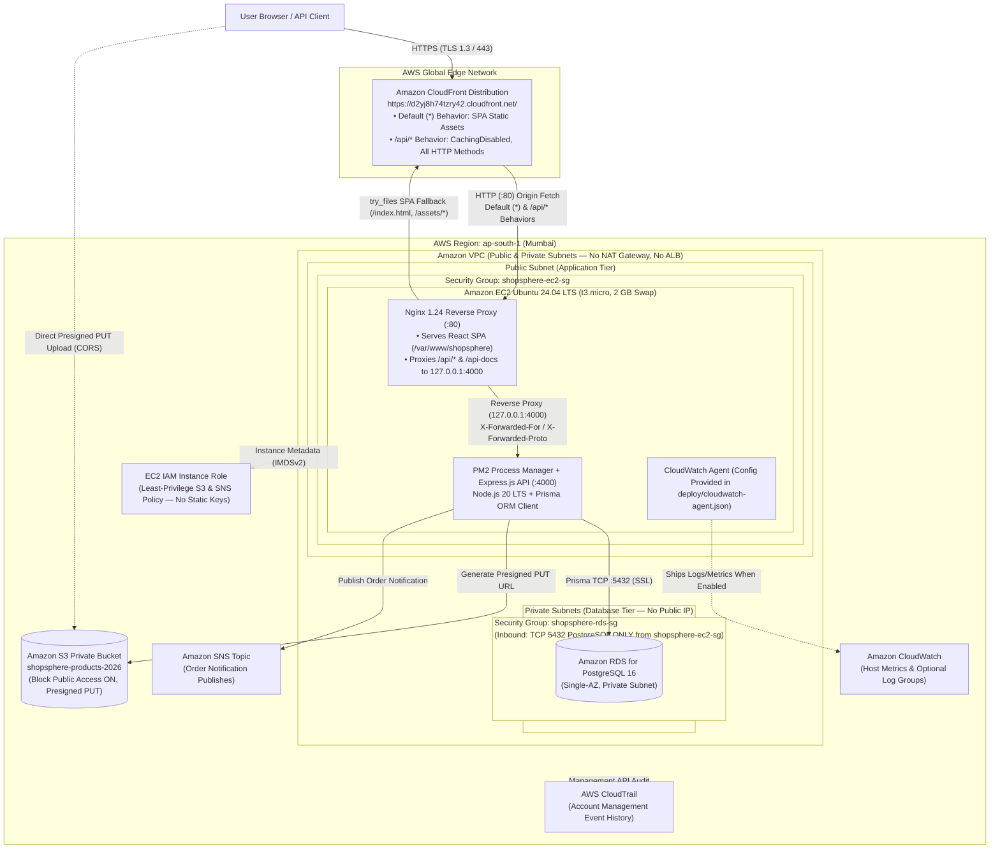

# Vellore Institute of Technology, Chennai

## School of Computer Science and Engineering

**Course code:** BCSE355L  
**Course name:** Cloud Architecture Design  
**Direct Assessment III: Max Marks: 10**

**Team members:**
- Adityaranjan Narayan — 24BCE1565
- Vedant Bidkar — 24BCE1596

**Faculty:** Dr. S Vigneshwari

---

## 1. Title

**ShopSphere: Cloud-Based E-Commerce Platform Using AWS Cloud Architecture**

---

## 2. Abstract

Modern e-commerce applications must deliver low-latency storefront browsing, transactional consistency during concurrent checkouts, strict isolation of relational customer data, and secure object storage without relying on hardcoded credentials or expensive, over-provisioned cloud appliances. **ShopSphere** is a full-stack, cloud-native e-commerce platform designed, deployed, and verified on **Amazon Web Services (AWS)** in the **Asia Pacific (Mumbai) region (`ap-south-1`)** for the BCSE355L Cloud Architecture Design course. The frontend is built with **React 18**, **Vite 6**, **TypeScript**, and **Tailwind CSS**, while the backend REST API is implemented in **Node.js 20 LTS**, **Express 4**, **Prisma ORM 6**, and **Zod** backed by **PostgreSQL 16**.

The deployed cloud architecture uses **Amazon CloudFront** (`https://d2yj8h74tzry42.cloudfront.net/`) as a global HTTPS termination and path-based routing layer in front of an **Ubuntu 24.04 LTS Amazon EC2 (`t3.micro`)** application server located in a public VPC subnet. **Nginx (`1.24.0`)** serves the compiled React single-page application (`/var/www/shopsphere`) with immutable caching for fingerprinted `/assets/*` bundles and reverse-proxies `/api/*` and `/api-docs` requests over loopback (`127.0.0.1:4000`) to a **PM2-managed Express** process. Transactional data—including users, addresses, products, carts, orders, payments, reviews, and inventory movements—resides in a **Single-AZ Amazon RDS for PostgreSQL 16** instance isolated within private subnets and guarded by security-group chaining (`shopsphere-rds-sg` accepting TCP `5432` solely from `shopsphere-ec2-sg`), eliminating the cost of a NAT Gateway or Application Load Balancer. Product image uploads use short-lived **Amazon S3** presigned `PUT` URLs targeting the private bucket `shopsphere-products-2026`, and order notifications integrate with **Amazon SNS**, both authenticated dynamically through an **EC2 IAM Instance Role** without static AWS access keys. End-to-end verification across local and live CloudFront endpoints confirms 100% pass rates across health, database connectivity, JWT claim whitelisting, registration, login, catalogue discovery, cart management, serializable order placement, and role-protected admin analytics.

---

## 3. Problem Statement

Small-to-medium academic and early-stage e-commerce deployments frequently suffer from three architectural pitfalls when migrating to the public cloud:

1. **Publicly Exposed Databases & Flat Network Topologies:** Placing relational databases on public subnets with `0.0.0.0/0` security group rules exposes customer records and order ledgers to brute-force and network-level attacks.
2. **Hardcoded Cloud Credentials & Over-Privileged Access:** Embedding static `AWS_ACCESS_KEY_ID` and `AWS_SECRET_ACCESS_KEY` strings in source repositories or `.env` files creates severe credential-leakage risks on public version-control platforms, while making S3 buckets world-writable exposes applications to unauthorized content hosting.
3. **Uncontrolled Cloud Infrastructure Costs & Mixed-Content Failures:** Provisioning managed NAT Gateways, Application Load Balancers, Multi-AZ database clusters, or separate frontend/backend origins often exhausts student credits rapidly and introduces browser CORS and HTTPS/HTTP mixed-content failures when a secure SPA attempts to call an unencrypted EC2 IP address.

The engineering objective of **ShopSphere** is to design and deploy a secure, production-hardened, full-stack e-commerce platform on AWS (`ap-south-1`) that resolves all three problems within **AWS Free Tier and student credit constraints**: enforcing public/private subnet separation without a NAT Gateway, terminating HTTPS globally via a single CloudFront origin with path-based API routing, executing ACID-compliant `Serializable` checkout transactions against private RDS PostgreSQL, and using least-privilege EC2 IAM roles for private S3 (`shopsphere-products-2026`) and SNS integrations.

---

## 4. Highlights / Novelty

1. **Single-Origin CloudFront Edge Routing (`Default *` vs. `/api/*` Behaviors):**
   - Eliminates browser CORS preflight overhead and HTTPS->HTTP mixed-content errors by serving both the React SPA and the Express REST API behind `https://d2yj8h74tzry42.cloudfront.net/`.
   - The Default (`*`) behavior caches static storefront assets at the edge, whereas the `/api/*` behavior enforces `CachingDisabled` (`X-Cache: Miss from cloudfront` verified on repeated calls), enables `GET, HEAD, OPTIONS, PUT, POST, PATCH, DELETE`, and forwards `Authorization` headers to Nginx.
2. **Zero-NAT, Zero-ALB Two-Tier VPC Security Group Chaining:**
   - The EC2 instance (`shopsphere-ec2-sg`) resides in a public subnet while Amazon RDS for PostgreSQL (`shopsphere-rds-sg`) resides in private subnets (`Publicly accessible = No`) and accepts TCP `5432` **exclusively** from `shopsphere-ec2-sg`. Because RDS requires no outbound internet initiation, the architecture achieves private database isolation at **$0 NAT Gateway cost**.
3. **Serializable ACID Checkout & Inventory Ledger:**
   - Order placement (`POST /api/orders`) executes inside a Prisma `Serializable` database transaction (`Prisma.TransactionIsolationLevel.Serializable`) that validates live stock, decrements product quantities, appends an auditable `InventoryMovement` (`ORDER_PLACED` / `ORDER_CANCELLED` / `ADMIN_STOCK_ADJUSTMENT`), creates `Order`, `OrderItem`, and `Payment` records, and clears the user's cart atomically.
4. **Defense-in-Depth Production Hardening:**
   - **Startup Fail-Fast & Seed Guards:** When `NODE_ENV=production`, the server refuses to boot if `DATABASE_URL` is missing or `JWT_SECRET` is shorter than 32 characters, and `prisma/seed.ts` refuses to run with default demo passwords (`DemoAdmin!234` / `DemoUser!234`).
   - **Strict JWT Claim Whitelisting:** `signToken()` explicitly signs only `{ id, role, email }`, preventing `passwordHash` or internal Prisma fields from leaking into bearer tokens (verified by automated regression test).
   - **Proxy-Aware Rate Limiting & Redacted JSON Logging:** Configures `app.set("trust proxy", Number(process.env.TRUST_PROXY ?? 1))` (`TRUST_PROXY=2` behind CloudFront + Nginx) before `express-rate-limit` (`30 requests / 15 min` on `/api/auth`) and logs one JSON line per request (`method`, `path`, `status`, `ms`) without logging `Authorization` headers or request bodies.
5. **Credential-Free AWS SDK Integration via IAM Instance Profile:**
   - Uses EC2 instance metadata credentials (`shopsphere-ec2-role`) scoped by [`deploy/iam/ec2-role-policy.json`](../deploy/iam/ec2-role-policy.json) to generate 300-second presigned `PUT` URLs for the private S3 bucket `shopsphere-products-2026` and publish order alerts to Amazon SNS.

---

## 5. Dataset Link and Citation

- **Dataset Status:** ShopSphere does **not** use an external third-party dataset or a custom registered dataset DOI. No dataset DOI is claimed.
- **Seeded Catalogue Data Source:** The application initializes its relational catalogue deterministically through the repository seed script **[`server/prisma/seed.ts`](../server/prisma/seed.ts)** against the 12-model Prisma schema **[`server/prisma/schema.prisma`](../server/prisma/schema.prisma)**.
- **Catalogue Composition:**
  - **6 Categories:** `Electronics`, `Fashion`, `Home & Kitchen`, `Books`, `Beauty & Personal Care`, `Sports & Fitness`.
  - **6 Brands:** `NovaTech`, `UrbanThread`, `CasaLiving`, `PageTurner`, `GlowTheory`, `ActivePulse`.
  - **8 Seeded Products (INR Pricing):**
    1. *NovaTech Wireless Headphones* (`novatech-wireless-headphones`) — ₹2,499 (MRP ₹3,999, stock 24, rating 4.6)
    2. *Smart Fitness Watch* (`smart-fitness-watch`) — ₹3,299 (MRP ₹4,999, stock 18, rating 4.4)
    3. *Everyday Canvas Sneakers* (`everyday-canvas-sneakers`) — ₹1,799 (MRP ₹2,499, stock 32, rating 4.3)
    4. *Minimal Desk Lamp* (`minimal-desk-lamp`) — ₹1,199 (MRP ₹1,599, stock 12, rating 4.5)
    5. *The Creative Thinker's Notebook* (`creative-thinkers-notebook`) — ₹499 (MRP ₹699, stock 60, rating 4.7)
    6. *Daily Hydration Serum* (`daily-hydration-serum`) — ₹699 (MRP ₹999, stock 40, rating 4.2)
    7. *Performance Training Bottle* (`performance-training-bottle`) — ₹399 (MRP ₹599, stock 50, rating 4.5)
    8. *Compact Bluetooth Speaker* (`compact-bluetooth-speaker`) — ₹1,599 (MRP ₹2,299, stock 16, rating 4.1)
- **Dataset / Seed Script Link:** https://github.com/AdityaNarayan1212/ShopSphere/blob/main/server/prisma/seed.ts
- **Dataset Citation (Internal Seeded Catalogue):**
  > Adityaranjan Narayan and Vedant Bidkar. (2026). *ShopSphere Seeded E-Commerce Product Catalogue (`server/prisma/seed.ts`)*. In *ShopSphere: Cloud-Based E-Commerce Platform Using AWS Cloud Architecture*. Vellore Institute of Technology, Chennai. https://github.com/AdityaNarayan1212/ShopSphere/blob/main/server/prisma/seed.ts

---

## 6. Project Demo Link

- **Live Storefront (Amazon CloudFront HTTPS):** https://d2yj8h74tzry42.cloudfront.net/
- **Live API Health Endpoint (`GET /api/health`):** https://d2yj8h74tzry42.cloudfront.net/api/health
- **Live Database Connectivity Endpoint (`GET /api/health/db`):** https://d2yj8h74tzry42.cloudfront.net/api/health/db
- **Live Product Catalogue Endpoint (`GET /api/products`):** https://d2yj8h74tzry42.cloudfront.net/api/products
- **Live OpenAPI / Swagger UI (`GET /api-docs/`):** https://d2yj8h74tzry42.cloudfront.net/api-docs/

---

## 7. GitHub Repository Link with the Required Citation

- **GitHub Repository URL:** https://github.com/AdityaNarayan1212/ShopSphere
- **Machine-Readable Citation File:** [`CITATION.cff`](../CITATION.cff) (Citation File Format `1.2.0`)
- **Required Academic Citation:**

> Adityaranjan Narayan and Vedant Bidkar. (2026). *ShopSphere: Cloud-Based E-Commerce Platform Using AWS Cloud Architecture*. Supervised by Dr. S Vigneshwari. Vellore Institute of Technology, Chennai. GitHub repository: https://github.com/AdityaNarayan1212/ShopSphere

---

## 8. Architecture Diagram

The canonical Mermaid diagram source is stored in **[`docs/architecture.mmd`](./architecture.mmd)** and documented in detail in **[`docs/aws-architecture.md`](./aws-architecture.md)**.

### Architectural Component Summary

| Layer | AWS Service / Component | Deployed Configuration & Role |
|---|---|---|
| **Edge & TLS Termination** | Amazon CloudFront (`d2yj8h74tzry42.cloudfront.net`) | Terminates HTTPS (`301` redirect from HTTP). Default (`*`) behavior serves SPA static files (`X-Cache: Hit from cloudfront`); `/api/*` behavior disables caching (`X-Cache: Miss from cloudfront`) and forwards all HTTP methods + `Authorization` headers to EC2 Nginx. |
| **Network Isolation** | Amazon VPC (`ap-south-1`) | Public subnet for EC2; private subnets across AZs for RDS. Intentionally omits NAT Gateway and ALB to stay within Free Tier / student credits. |
| **Compute & Web Tier** | Amazon EC2 (`t3.micro`, Ubuntu 24.04 LTS) | Configured via [`deploy/setup-ec2.sh`](../deploy/setup-ec2.sh) with 2 GB swapfile, Nginx `1.24.0`, Node.js 20 LTS, and PM2 (`api` process). Guarded by `shopsphere-ec2-sg`. |
| **Reverse Proxy & SPA Host** | Nginx (`1.24.0`) | Serves `/var/www/shopsphere` with `try_files $uri $uri/ /index.html` fallback, 1-year immutable cache on `/assets/*`, gzip compression, and loopback proxy to `127.0.0.1:4000` for `/api/` and `/api-docs`. |
| **Application Server** | Express.js + Prisma 6 + PM2 | Runs `server/dist/index.js` on port `4000`; enforces `Helmet`, `CORS`, `express-rate-limit`, `Zod` validation, and `Serializable` checkout transactions. |
| **Relational Database** | Amazon RDS for PostgreSQL 16 (Single-AZ) | Provisioned in private subnets (`Publicly accessible = No`); `shopsphere-rds-sg` permits inbound TCP `5432` solely from `shopsphere-ec2-sg`. |
| **Object Storage** | Amazon S3 (`shopsphere-products-2026`) | Private bucket (`Block all public access = ON`); backend issues 300-second presigned `PUT` URLs (`POST /api/admin/uploads/presign`) using the EC2 IAM role. |
| **Notifications** | Amazon SNS | Publishes order placement alerts (`Subject: "ShopSphere order update"`) via `@aws-sdk/client-sns` using the EC2 IAM role. |
| **Observability & Audit** | Amazon CloudWatch & AWS CloudTrail | Express writes structured JSON request logs to PM2 logs; [`deploy/cloudwatch-agent.json`](../deploy/cloudwatch-agent.json) provides `/shopsphere/nginx`, `/shopsphere/api`, and memory/disk metric collection configuration; AWS CloudTrail records account management events. |

---

## 9. Screenshots

Screenshots for the Word report are organized and tracked through **[`docs/screenshots/README.md`](./screenshots/README.md)**. Insert the 12 genuine, redacted captures into the Word document in the following order:

1. **Figure 1 (`docs/screenshots/01-homepage-cloudfront-https.png`):** ShopSphere storefront loaded over CloudFront HTTPS (`https://d2yj8h74tzry42.cloudfront.net/`).
2. **Figure 2 (`docs/screenshots/02-product-catalogue-seeded.png`):** Product catalogue page (`/products`) displaying the 8 seeded items and INR prices.
3. **Figure 3 (`docs/screenshots/03-product-detail-page.png`):** Product detail view (`/products/novatech-wireless-headphones`) with description, stock count, and related products.
4. **Figure 4 (`docs/screenshots/04-search-and-category-filter.png`):** Search and multi-criteria filtering (`category`, `sort`, `minPrice`/`maxPrice`, `inStock`, `rating`).
5. **Figure 5 (`docs/screenshots/05-shopping-cart.png`):** Authenticated customer shopping cart (`/cart`) with quantity controls and order summary.
6. **Figure 6 (`docs/screenshots/06-customer-login.png`):** Customer sign-in interface (`/login`).
7. **Figure 7 (`docs/screenshots/07-checkout-and-order-confirmation.png`):** Checkout address entry (`/checkout`) and confirmed order (`SS-...`) in Order History (`/orders`).
8. **Figure 8 (`docs/screenshots/08-admin-dashboard.png`):** Admin Dashboard (`/admin`) showing aggregate KPIs (`products`, `customers`, `orders`, `pending`, `revenue`) and recent orders.
9. **Figure 9 (`docs/screenshots/09-admin-product-management.png`):** Admin product creation and order-status management interface.
10. **Figure 10 (`docs/screenshots/10-api-health-endpoints.png`):** Live JSON responses from `https://d2yj8h74tzry42.cloudfront.net/api/health` and `/api/health/db`.
11. **Figure 11 (`docs/screenshots/11-aws-console-architecture-redacted.png`):** Redacted AWS Console views of CloudFront, EC2, private RDS, and security groups (`shopsphere-ec2-sg`, `shopsphere-rds-sg`).
12. **Figure 12 (`docs/screenshots/12-s3-sns-cloudwatch-evidence.png`):** Redacted AWS Console / email evidence for private S3 bucket `shopsphere-products-2026`, SNS order notifications, and verified CloudWatch/CloudTrail views.

---

## 10. Results

### 10.1 Verified Live CloudFront & Production API Checks (Executed October 25, 2026)

Read-only verification was executed directly against the live production deployment at `https://d2yj8h74tzry42.cloudfront.net/`:

| Check ID | Target URL / Route | HTTP Method | Observed Status | Verified Response / Header Evidence | Result |
|---|---|---|---|---|---|
| **LIVE-01** | `http://d2yj8h74tzry42.cloudfront.net/` | `GET` | `301 Moved Permanently` | Redirects to `Location: https://d2yj8h74tzry42.cloudfront.net/` | **PASS** |
| **LIVE-02** | `https://d2yj8h74tzry42.cloudfront.net/` | `GET` | `200 OK` | `Content-Type: text/html`, `Server: nginx/1.24.0 (Ubuntu)`, `X-Cache: Hit from cloudfront`, `<title>ShopSphere \| Everyday finds, delivered</title>` | **PASS** |
| **LIVE-03** | `https://d2yj8h74tzry42.cloudfront.net/products` & `/admin` | `GET` | `200 OK` | Nginx `try_files` SPA fallback returns `index.html` (`200 OK`) for client-side React Router paths | **PASS** |
| **LIVE-04** | `https://d2yj8h74tzry42.cloudfront.net/assets/<bundle>.js` | `GET` | `200 OK` | `X-Cache: Hit from cloudfront`, `Cache-Control: public, max-age=31536000, immutable` | **PASS** |
| **LIVE-05** | `https://d2yj8h74tzry42.cloudfront.net/api/health` | `GET` | `200 OK` | `{"status":"ok","service":"shopsphere-api","timestamp":"2026-10-25T17:36:20.740Z"}`, `X-Cache: Miss from cloudfront`, Helmet security headers (`Strict-Transport-Security`, `Content-Security-Policy`, `X-Content-Type-Options`, `X-Frame-Options`) | **PASS** |
| **LIVE-06** | `https://d2yj8h74tzry42.cloudfront.net/api/health/db` | `GET` | `200 OK` | `{"status":"ok","db":"up","timestamp":"2026-10-25T17:36:21.161Z"}` (confirms live Prisma `SELECT 1` against private RDS PostgreSQL) | **PASS** |
| **LIVE-07** | `https://d2yj8h74tzry42.cloudfront.net/api/products?limit=48` | `GET` | `200 OK` | `total: 8` seeded products returned; repeated calls return `X-Cache: Miss from cloudfront` (confirming `/api/*` caching is disabled) | **PASS** |
| **LIVE-08** | `https://d2yj8h74tzry42.cloudfront.net/api/categories` | `GET` | `200 OK` | Returns all 6 seeded categories (`Beauty & Personal Care`, `Books`, `Electronics`, `Fashion`, `Home & Kitchen`, `Sports & Fitness`) | **PASS** |
| **LIVE-09** | `https://d2yj8h74tzry42.cloudfront.net/api/auth/me` (with & without `Authorization` header) | `GET` | `401 Unauthorized` | Without header: `{"error":"Authentication required"}`; with invalid bearer token: `{"error":"Invalid or expired token"}` (confirms CloudFront `/api/*` forwards `Authorization` header to Express) | **PASS** |
| **LIVE-10** | `https://d2yj8h74tzry42.cloudfront.net/api/admin/dashboard` (unauthenticated) | `GET` | `401 Unauthorized` | Protected admin endpoint rejects unauthenticated requests | **PASS** |
| **LIVE-11** | `https://d2yj8h74tzry42.cloudfront.net/api-docs/` | `GET` | `200 OK` | Swagger UI served through Nginx reverse proxy | **PASS** |

### 10.2 Verified Local End-to-End & Automated Regression Suite

| Test Suite / Check | Command Executed | Verified Outcome | Result |
|---|---|---|---|
| **Monorepo Production Build** | `npm run build` | `server` (`tsc`) and `client` (`tsc -b && vite build`, 1,637 modules transformed) compiled with zero errors | **PASS** |
| **Automated Node Test Runner** | `REQUIRE_API_TEST=1 npm test` | `2 / 2` tests passed in [`server/test/health.test.js`](../server/test/health.test.js): (1) `/api/health` + `/api/health/db` contract; (2) JWT payload contains only `["email","exp","iat","id","role"]` and `passwordHash === undefined` | **PASS** |
| **Bash End-to-End Smoke Script** | `bash scripts/smoke-test.sh` | `6 / 6` steps passed against both direct API (`:4000`) and relative `/api` proxy (`:5173`): health, register, login, products, cart, address + order creation | **PASS** |
| **PowerShell 15-Step Smoke Suite** | `smoke.ps1` | `15 / 15` steps passed, including cart auto-empty after checkout, admin dashboard `200 OK` for `Role.ADMIN`, and `403 Forbidden` for `Role.CUSTOMER` | **PASS** |
| **Production Fail-Fast & Seed Guards** | `NODE_ENV=production` negative tests | Server aborted startup on short `JWT_SECRET`; `seed.ts` aborted when `SEED_ADMIN_PASSWORD=DemoAdmin!234` in production | **PASS** |

### 10.3 Pending / Uncollected Measurements (Not Fabricated)

In accordance with academic integrity guidelines, the following quantitative metrics have **not** been fabricated and remain marked as pending until explicitly executed and recorded by the team:

- **k6 Load Test Quantitative Metrics (`loadtest/k6.js`):** The load-testing script ([`loadtest/k6.js`](../loadtest/k6.js)) is configured for 10 virtual users over 60 seconds with thresholds `http_req_duration p(95) < 500ms` and `http_req_failed < 0.01`, but `k6` has not yet been executed against the live CloudFront/EC2 endpoint to avoid generating synthetic load without prior scheduling. Exact `p(50)`, `p(95)`, `p(99)`, and RPS figures are **pending execution**.
- **Exact AWS Billing / Pricing Calculator Totals (`docs/cost-estimate.md`):** Service-level free-tier allowances are documented in [`docs/cost-estimate.md`](./cost-estimate.md), while exact dollar figures remain marked `TODO: verify in AWS Pricing Calculator`.

---

## 11. Conclusion

ShopSphere demonstrates that a complete, production-hardened e-commerce application can be architected and deployed on AWS (`ap-south-1`) within student and Free Tier constraints without compromising security or transactional integrity. By combining **Amazon CloudFront** path-based edge routing (`*` and `/api/*`), **Nginx + PM2** on **Ubuntu 24.04 EC2**, private-subnet **Amazon RDS for PostgreSQL 16** with security-group chaining, and **IAM Instance Role** integration for private **Amazon S3 (`shopsphere-products-2026`)** presigned uploads and **Amazon SNS** order notifications, the platform eliminates static cloud keys, public database exposure, mixed-content browser errors, and costly NAT Gateway/ALB charges. All core functional, security, and health workflows have been verified end-to-end on the live deployment (`https://d2yj8h74tzry42.cloudfront.net/`).

---

## 12. References (36 Verified Sources with DOIs and Direct Web Links)

*(Full annotated bibliography is also maintained in [`docs/references.md`](./references.md).)*

1. Armbrust, M., Fox, A., Griffith, R., Joseph, A. D., et al. (2010). "A View of Cloud Computing." *Communications of the ACM*, 53(4), 50–58. https://doi.org/10.1145/1721654.1721672
2. Mell, P. M., & Grance, T. (2011). *The NIST Definition of Cloud Computing*. NIST Special Publication 800-145. https://doi.org/10.6028/NIST.SP.800-145
3. Liu, F., Tong, J., Mao, J., Bohn, R., et al. (2011). *NIST Cloud Computing Reference Architecture*. NIST Special Publication 500-292. https://doi.org/10.6028/NIST.SP.500-292
4. Jansen, W., & Grance, T. (2011). *Guidelines on Security and Privacy in Public Cloud Computing*. NIST Special Publication 800-144. https://doi.org/10.6028/NIST.SP.800-144
5. Buyya, R., Yeo, C. S., Venugopal, S., Broberg, J., & Brandic, I. (2009). "Cloud computing and emerging IT platforms: Vision, hype, and reality for delivering computing as the 5th utility." *Future Generation Computer Systems*, 25(6), 599–616. https://doi.org/10.1016/j.future.2008.12.001
6. Zhang, Q., Cheng, L., & Boutaba, R. (2010). "Cloud computing: state-of-the-art and research challenges." *Journal of Internet Services and Applications*, 1(1), 7–18. https://doi.org/10.1007/s13174-010-0007-6
7. Subashini, S., & Kavitha, V. (2011). "A survey on security issues in service delivery models of cloud computing." *Journal of Network and Computer Applications*, 34(1), 1–11. https://doi.org/10.1016/j.jnca.2010.07.006
8. Ali, M., Khan, S. U., & Vasilakos, A. V. (2015). "Security in cloud computing: Opportunities and challenges." *Information Sciences*, 305, 357–383. https://doi.org/10.1016/j.ins.2015.01.025
9. Kratzke, N., & Quint, P.-C. (2017). "Understanding cloud-native applications after 10 years of cloud computing — A systematic mapping study." *Journal of Systems and Software*, 126, 1–16. https://doi.org/10.1016/j.jss.2017.01.001
10. Al-Dhuraibi, Y., Paraiso, F., Djarallah, N., & Merle, P. (2018). "Elasticity in Cloud Computing: State of the Art and Research Challenges." *IEEE Transactions on Services Computing*, 11(2), 430–447. https://doi.org/10.1109/TSC.2017.2711009
11. Nygren, E., Sitaraman, R. K., & Sun, J. (2010). "The Akamai network: a platform for high-performance internet applications." *ACM SIGOPS Operating Systems Review*, 44(3), 2–19. https://doi.org/10.1145/1842733.1842736
12. Fielding, R. T., & Taylor, R. N. (2002). "Principled design of the modern Web architecture." *ACM Transactions on Internet Technology*, 2(2), 115–150. https://doi.org/10.1145/514183.514185
13. Gefen, D., Karahanna, E., & Straub, D. W. (2003). "Trust and TAM in Online Shopping: An Integrated Model." *MIS Quarterly*, 27(1), 51–90. https://doi.org/10.2307/30036519
14. Marston, S., Li, Z., Bandyopadhyay, S., Zhang, J., & Ghalsasi, A. (2011). "Cloud computing — The business perspective." *Decision Support Systems*, 51(1), 176–189. https://doi.org/10.1016/j.dss.2010.12.006
15. Jones, M., Bradley, J., & Sakimura, N. (2015). *JSON Web Token (JWT)*. IETF RFC 7519. https://doi.org/10.17487/RFC7519
16. Provos, N., & Mazières, D. (1999). "A Future-Adaptable Password Scheme." *Proceedings of the 1999 USENIX Annual Technical Conference (FREENIX Track)*, pp. 81–91. https://www.usenix.org/legacy/events/usenix99/provos/provos.pdf
17. Amazon Web Services. *What is Amazon CloudFront? — Amazon CloudFront Developer Guide*. https://docs.aws.amazon.com/AmazonCloudFront/latest/DeveloperGuide/Introduction.html
18. Amazon Web Services. *Cache behavior settings — Amazon CloudFront Developer Guide*. https://docs.aws.amazon.com/AmazonCloudFront/latest/DeveloperGuide/DownloadDistValuesCacheBehavior.html
19. Amazon Web Services. *What is Amazon EC2? — Amazon EC2 User Guide*. https://docs.aws.amazon.com/AWSEC2/latest/UserGuide/concepts.html
20. Amazon Web Services. *IAM roles for Amazon EC2 — Amazon EC2 User Guide*. https://docs.aws.amazon.com/AWSEC2/latest/UserGuide/iam-roles-for-amazon-ec2.html
21. Amazon Web Services. *Subnets for your VPC — Amazon VPC User Guide*. https://docs.aws.amazon.com/vpc/latest/userguide/configure-subnets.html
22. Amazon Web Services. *Control traffic to your AWS resources using security groups — Amazon VPC User Guide*. https://docs.aws.amazon.com/vpc/latest/userguide/vpc-security-groups.html
23. Amazon Web Services. *Amazon RDS for PostgreSQL — Amazon RDS User Guide*. https://docs.aws.amazon.com/AmazonRDS/latest/UserGuide/CHAP_PostgreSQL.html
24. Amazon Web Services. *Blocking public access to your Amazon S3 storage — Amazon S3 User Guide*. https://docs.aws.amazon.com/AmazonS3/latest/userguide/access-control-block-public-access.html
25. Amazon Web Services. *Download and upload objects with presigned URLs — Amazon S3 User Guide*. https://docs.aws.amazon.com/AmazonS3/latest/userguide/using-presigned-url.html
26. Amazon Web Services. *Security best practices in IAM — AWS IAM User Guide*. https://docs.aws.amazon.com/IAM/latest/UserGuide/best-practices.html
27. Amazon Web Services. *What is Amazon SNS? — Amazon SNS Developer Guide*. https://docs.aws.amazon.com/sns/latest/dg/welcome.html
28. Amazon Web Services. *Collect metrics, logs, and traces using the CloudWatch agent — Amazon CloudWatch User Guide*. https://docs.aws.amazon.com/AmazonCloudWatch/latest/monitoring/Install-CloudWatch-Agent.html
29. Amazon Web Services. *Working with CloudTrail event history — AWS CloudTrail User Guide*. https://docs.aws.amazon.com/awscloudtrail/latest/userguide/view-cloudtrail-events.html
30. Amazon Web Services. *AWS Well-Architected Framework*. https://docs.aws.amazon.com/wellarchitected/latest/framework/welcome.html
31. The PostgreSQL Global Development Group. *PostgreSQL 16 Official Documentation*. https://www.postgresql.org/docs/16/index.html
32. OpenJS Foundation. *Express.js Guide: Express Behind Proxies*. https://expressjs.com/en/guide/behind-proxies/
33. Meta Open Source & VoidZero. *React Documentation* (https://react.dev/) and *Vite Guide* (https://vite.dev/guide/).
34. Prisma Data, Inc. *How Migrations Work in Prisma ORM — Prisma Documentation*. https://www.prisma.io/docs/orm/migrations/how-migrations-work
35. F5 / Nginx, Inc. *Module `ngx_http_proxy_module` — Nginx Documentation*. https://nginx.org/en/docs/http/ngx_http_proxy_module.html
36. OWASP Foundation. *OWASP REST Security Cheat Sheet*. https://cheatsheetseries.owasp.org/cheatsheets/REST_Security_Cheat_Sheet.html

---

## 13. Research Paper Appendix Status

- **Current Status:** A separate research paper manuscript or preprint has **not** been prepared or submitted at this stage, and no external paper link or DOI is claimed.
- **Future Enhancement / Optional Appendix:** The architectural analysis, cost-avoidance comparison (Zero-NAT/Zero-ALB CloudFront-to-EC2 pattern vs. traditional multi-tier ALB + NAT Gateway deployments), and `k6` latency benchmarks from ShopSphere are planned as an optional future technical report extension.
