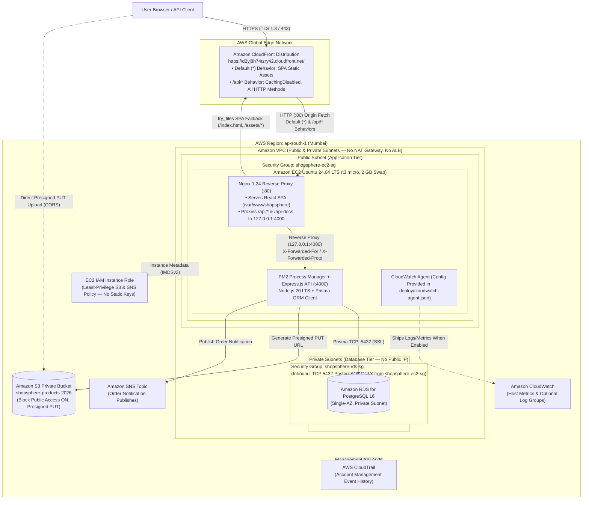

# ShopSphere AWS Architecture (`ap-south-1`)

**Live Storefront & API Entry Point:** https://d2yj8h74tzry42.cloudfront.net/  
**GitHub Repository:** https://github.com/AdityaNarayan1212/ShopSphere

---

## 1. Architecture Overview

ShopSphere is deployed in the **AWS Asia Pacific (Mumbai) region (`ap-south-1`)** using a cost-aware, two-tier VPC topology fronted by **Amazon CloudFront**. The architecture is designed for the VIT Chennai **BCSE355L Cloud Architecture Design (DA III)** assessment to demonstrate defense-in-depth network isolation, credential-free IAM service integration, and reverse-proxy single-origin routing without incurring charges from paid-by-default networking appliances (no NAT Gateway, no Application Load Balancer, no Elastic Beanstalk, no Multi-AZ RDS, and no ElastiCache).

---

## 2. Accessibility & Textual Walkthrough of the Request and Data Flow

For screen readers and print evaluation, the end-to-end request lifecycle operates across five logical boundaries:

1. **Client to Edge (`Browser -> Amazon CloudFront`):**
   - Users access `https://d2yj8h74tzry42.cloudfront.net/` over HTTPS. Plain HTTP requests (`http://d2yj8h74tzry42.cloudfront.net/`) receive an immediate `301 Moved Permanently` redirect to `https://`.
   - The CloudFront distribution uses the EC2 Nginx server as its origin and defines two path behaviors:
     - **Default (`*`) behavior:** Serves the compiled React 18 + Vite single-page application (`index.html` and fingerprinted `/assets/*` bundles with `Cache-Control: public, max-age=31536000, immutable`).
     - **API (`/api/*`) behavior:** Configured with **caching disabled** (`X-Cache: Miss from cloudfront` on every request), all REST methods enabled (`GET, HEAD, OPTIONS, PUT, POST, PATCH, DELETE`), and viewer headers (`Authorization`, `Content-Type`, query strings) forwarded to the origin.

2. **Public Application Tier (`CloudFront -> EC2 Ubuntu 24.04 -> Nginx -> PM2 / Express`):**
   - Requests enter the VPC public subnet through the Internet Gateway and reach the Ubuntu 24.04 EC2 instance (`t3.micro` with a 2 GB swapfile configured via [`deploy/setup-ec2.sh`](../deploy/setup-ec2.sh)), protected by security group `shopsphere-ec2-sg`.
   - **Nginx (`1.24.0`)** listens on TCP port `80` ([`deploy/nginx.conf`](../deploy/nginx.conf)):
     - Static routes (`/`, `/products`, `/cart`, `/admin`, etc.) resolve against `/var/www/shopsphere` with `try_files $uri $uri/ /index.html` so React Router (`BrowserRouter`) deep links render without `404` errors.
     - API routes (`/api/*`) and Swagger documentation (`/api-docs`) are reverse-proxied over loopback (`http://127.0.0.1:4000`) with `X-Real-IP`, `X-Forwarded-For`, and `X-Forwarded-Proto` headers attached.
   - **Express.js (`server/src/index.ts`)** runs under **PM2** ([`deploy/ecosystem.config.cjs`](../deploy/ecosystem.config.cjs)) on `127.0.0.1:4000` with `app.set("trust proxy", Number(process.env.TRUST_PROXY ?? 1))` so rate limiting (`express-rate-limit` on `/api/auth`) evaluates the real client IP behind CloudFront and Nginx.

3. **Private Database Tier (`Express -> Amazon RDS for PostgreSQL`):**
   - Express connects via Prisma ORM (`@prisma/client`) over TCP port `5432` to a **Single-AZ Amazon RDS for PostgreSQL 16** instance located in private subnets (`Publicly accessible = No`).
   - Database security group `shopsphere-rds-sg` permits inbound TCP `5432` **only** from `shopsphere-ec2-sg`. No internet host can reach the database directly, and because RDS initiates no outbound internet connections, **no NAT Gateway is required**.

4. **Credential-Free AWS Service Integrations (`EC2 IAM Role -> S3 & SNS`):**
   - The EC2 instance assumes an IAM instance profile scoped by [`deploy/iam/ec2-role-policy.json`](../deploy/iam/ec2-role-policy.json). No static `AWS_ACCESS_KEY_ID` or `AWS_SECRET_ACCESS_KEY` values are stored on disk or in environment files.
   - **Amazon S3 (`shopsphere-products-2026`):** A private S3 bucket (`Block all public access = ON`) stores product images under `products/<uuid>.<ext>`. The admin endpoint `POST /api/admin/uploads/presign` uses `@aws-sdk/s3-request-presigner` to generate a 300-second presigned `PUT` URL. No separate S3 CloudFront distribution is deployed; seeded catalogue products use curated HTTPS image URLs while `shopsphere-products-2026` supports the presigned upload workflow.
   - **Amazon SNS:** When an order is placed (`POST /api/orders`) and `SNS_ORDER_TOPIC_ARN` is configured, `notifyOrder()` publishes an order summary (`Subject: "ShopSphere order update"`) to the configured Amazon SNS topic using `@aws-sdk/client-sns`. If `SNS_ORDER_TOPIC_ARN` is unset, the server falls back to structured console logging without failing the checkout transaction.

5. **Observability & Auditing (`CloudWatch & CloudTrail`):**
   - **Application Logging:** Express emits one structured JSON log line per HTTP request (`{"method","path","status","ms"}`) to standard output (captured by PM2 in `~/.pm2/logs/`), intentionally omitting `Authorization` headers and request bodies.
   - **CloudWatch Agent & CloudTrail Status:** Standard EC2/RDS host metrics and default AWS CloudTrail 90-day management event history are available in the AWS Console by default. Repository configuration [`deploy/cloudwatch-agent.json`](../deploy/cloudwatch-agent.json) defines log shipping for `/shopsphere/nginx` and `/shopsphere/api` plus memory/disk metrics; however, active log-stream delivery and custom persistent CloudTrail trails must be verified in the AWS Console (see [`docs/screenshots/README.md`](./screenshots/README.md)) rather than assumed from the configuration file alone.
